# PromptVault ER Diagram — Current 24 Logical Tables

This ER diagram reflects the current `public` schema at revision 033.

It contains **24 logical tables**. The monthly `runs_*` tables are physical
PostgreSQL partitions of the one logical `runs` entity, so they are not separate
entities in this diagram. Views and materialized views are derived projections
and are also excluded.

```mermaid
erDiagram
    api_tokens {
        uuid id PK
    }
    audit_events {
        bigint id PK
    }
    auth_sessions {
        uuid id PK
    }
    spend_limits {
        uuid id PK
    }
    deployment_rollbacks {
        uuid deployment_id PK
    }
    deployments {
        uuid id PK
    }
    email_verification_tokens {
        uuid id PK
    }
    model_pricing {
        uuid id PK
    }
    password_history {
        uuid id PK
    }
    password_reset_tokens {
        uuid id PK
    }
    project_invitations {
        uuid id PK
    }
    project_members {
        uuid project_id PK
        uuid user_id PK
    }
    projects {
        uuid id PK
    }
    prompt_version_parents {
        uuid version_id PK
    }
    prompt_version_variables {
        uuid version_id PK
        integer ordinal PK
    }
    prompt_versions {
        uuid id PK
    }
    prompts {
        uuid id PK
    }
    provider_keys {
        uuid id PK
    }
    reservation_results {
        uuid reservation_id PK
    }
    run_inputs {
        uuid run_id PK
        timestamptz run_created_at PK
        text name PK
    }
    run_reservations {
        uuid id PK
    }
    runs {
        uuid id PK
        timestamptz created_at PK
    }
    schema_migrations {
        bigint version PK
    }
    users {
        uuid id PK
    }

    users ||--o{ api_tokens : created_by
    projects ||--o{ api_tokens : project_id
    users o|--o{ api_tokens : revoked_by
    users o|--o{ audit_events : actor_user_id
    users ||--o{ auth_sessions : user_id
    users o|--o{ spend_limits : created_by
    projects o|--o{ spend_limits : project_id
    users o|--o{ spend_limits : user_id
    deployments ||--o| deployment_rollbacks : deployment_id
    deployments ||--o{ deployment_rollbacks : rollback_of_id
    users ||--o{ deployments : requested_by
    users o|--o{ deployments : reviewed_by
    prompt_versions ||--o{ deployments : version_id
    users ||--o{ email_verification_tokens : user_id
    users o|--o{ model_pricing : created_by
    users ||--o{ password_history : user_id
    users ||--o{ password_reset_tokens : user_id
    users ||--o{ project_invitations : invited_by
    projects ||--o{ project_invitations : project_id
    users ||--o{ project_invitations : user_id
    users o|--o{ project_members : added_by
    projects ||--o{ project_members : project_id
    users ||--o{ project_members : user_id
    users ||--o{ projects : owner_id
    prompt_versions ||--o{ prompt_version_parents : parent_version_id
    prompt_versions ||--o| prompt_version_parents : version_id
    prompt_versions ||--o{ prompt_version_variables : version_id
    users ||--o{ prompt_versions : created_by
    prompts ||--o{ prompt_versions : prompt_id
    projects ||--o{ prompts : project_id
    users ||--o{ provider_keys : created_by
    run_reservations ||--o| reservation_results : reservation_id
    runs ||--o{ reservation_results : run_id_run_created_at
    runs ||--o{ run_inputs : run_id_run_created_at
    users ||--o{ run_reservations : user_id
    prompt_versions ||--o{ run_reservations : version_id
    users ||--o{ runs : user_id
    prompt_versions ||--o{ runs : version_id
```

## Logical-table inventory

1. `api_tokens`
2. `audit_events`
3. `auth_sessions`
4. `spend_limits`
5. `deployment_rollbacks`
6. `deployments`
7. `email_verification_tokens`
8. `model_pricing`
9. `password_history`
10. `password_reset_tokens`
11. `project_invitations`
12. `project_members`
13. `projects`
14. `prompt_version_parents`
15. `prompt_version_variables`
16. `prompt_versions`
17. `prompts`
18. `provider_keys`
19. `reservation_results`
20. `run_inputs`
21. `run_reservations`
22. `runs`
23. `schema_migrations`
24. `users`

For column-level definitions, constraints, and alternate keys, see the
[data dictionary](data-dictionary.md). The full relational description remains
available in [erd.md](erd.md).

