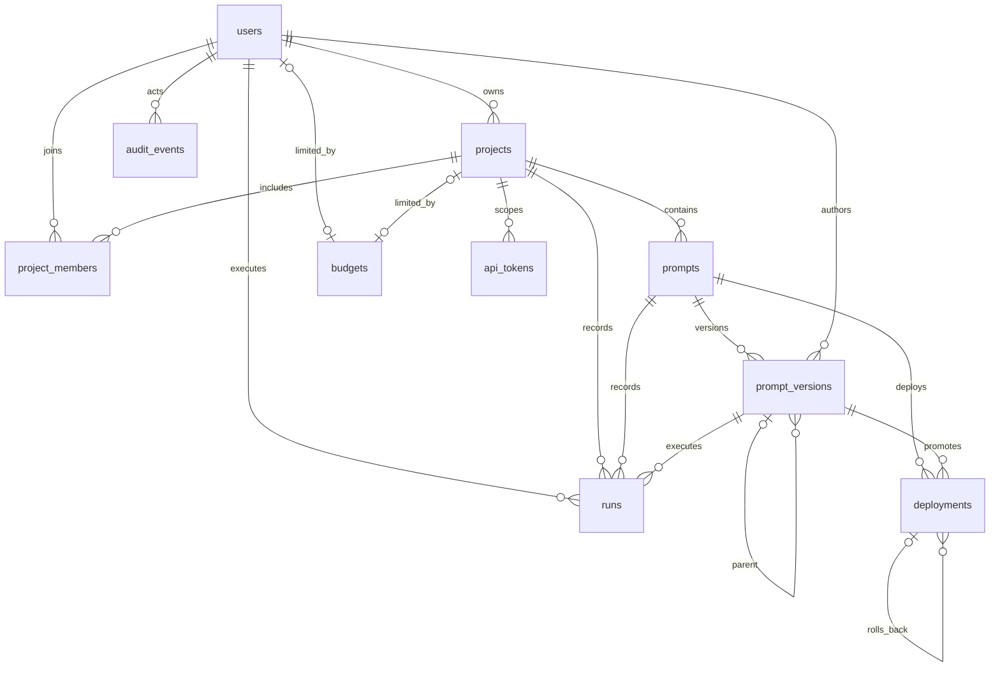

# PromptVault v1 entity relationships

## Entity summary

| Entity | Identity and ownership | Important invariants |
|---|---|---|
| `users` | UUID; normalized `citext` email | Case-insensitive unique email; `user`/`admin`; last active admin protected |
| `projects` | Owned by one user | Globally unique stable key; owner membership inserted automatically |
| `project_members` | Project/user composite key | No duplicate membership; owner membership cannot be deleted |
| `prompts` | Belongs to one project | Key unique within project |
| `prompt_versions` | Belongs to one prompt and author | Immutable; unique per-prompt version; parent must belong to same prompt |
| `runs` | User/project/prompt/version ledger row | Append-only; monthly range partition; exact decimal cost |
| `model_pricing` | Provider/model effective window | Nonnegative prices; no overlapping effective windows |
| `budgets` | Exactly one user or project target | One row per target; nonnegative monthly limit |
| `deployments` | Prompt/version/environment event | Version belongs to prompt; one active event per prompt/environment |
| `api_tokens` | Scoped to one project | Only prefix and SHA-256 hash persist; revocation metadata retained |
| `provider_keys` | Created by an administrator | Encrypted value only; active aliases unique per provider |
| `audit_events` | Optional actor plus resource snapshot | Append-only; sensitive fields removed by trigger |

`organization_monthly_metrics` and `user_monthly_metrics` are refreshable materialized views over the partitioned run ledger. `prompt_version_lineage`, `deployment_history`, and `monthly_costs` provide read-oriented projections without duplicating source-of-truth data.
