# Database entity relationships and relational schema

Revision 033 has 24 logical tables in `public`. Monthly `runs_*` partitions implement the single `runs` entity. Views and materialized views are derived projections. This document describes the implemented design; historical design-before-implementation evidence for the original project remains a separate submission limitation.

```mermaid
erDiagram
    api_tokens {
        uuid id PK
    }
    audit_events {
        bigint id PK
    }
    auth_sessions {
        uuid id PK
    }
    spend_limits {
        uuid id PK
    }
    deployment_rollbacks {
        uuid deployment_id PK
    }
    deployments {
        uuid id PK
    }
    email_verification_tokens {
        uuid id PK
    }
    model_pricing {
        uuid id PK
    }
    password_history {
        uuid id PK
    }
    password_reset_tokens {
        uuid id PK
    }
    project_invitations {
        uuid id PK
    }
    project_members {
        uuid project_id PK
        uuid user_id PK
    }
    projects {
        uuid id PK
    }
    prompt_version_parents {
        uuid version_id PK
    }
    prompt_version_variables {
        uuid version_id PK
        integer ordinal PK
    }
    prompt_versions {
        uuid id PK
    }
    prompts {
        uuid id PK
    }
    provider_keys {
        uuid id PK
    }
    reservation_results {
        uuid reservation_id PK
    }
    run_inputs {
        uuid run_id PK
        timestamptz run_created_at PK
        text name PK
    }
    run_reservations {
        uuid id PK
    }
    runs {
        uuid id PK
        timestamptz created_at PK
    }
    schema_migrations {
        bigint version PK
    }
    users {
        uuid id PK
    }
    users ||--o{ api_tokens : created_by
    projects ||--o{ api_tokens : project_id
    users o|--o{ api_tokens : revoked_by
    users o|--o{ audit_events : actor_user_id
    users ||--o{ auth_sessions : user_id
    users o|--o{ spend_limits : created_by
    projects o|--o{ spend_limits : project_id
    users o|--o{ spend_limits : user_id
    deployments ||--o| deployment_rollbacks : deployment_id
    deployments ||--o{ deployment_rollbacks : rollback_of_id
    users ||--o{ deployments : requested_by
    users o|--o{ deployments : reviewed_by
    prompt_versions ||--o{ deployments : version_id
    users ||--o{ email_verification_tokens : user_id
    users o|--o{ model_pricing : created_by
    users ||--o{ password_history : user_id
    users ||--o{ password_reset_tokens : user_id
    users ||--o{ project_invitations : invited_by
    projects ||--o{ project_invitations : project_id
    users ||--o{ project_invitations : user_id
    users o|--o{ project_members : added_by
    projects ||--o{ project_members : project_id
    users ||--o{ project_members : user_id
    users ||--o{ projects : owner_id
    prompt_versions ||--o{ prompt_version_parents : parent_version_id
    prompt_versions ||--o| prompt_version_parents : version_id
    prompt_versions ||--o{ prompt_version_variables : version_id
    users ||--o{ prompt_versions : created_by
    prompts ||--o{ prompt_versions : prompt_id
    projects ||--o{ prompts : project_id
    users ||--o{ provider_keys : created_by
    run_reservations ||--o| reservation_results : reservation_id
    runs ||--o{ reservation_results : run_id_run_created_at
    runs ||--o{ run_inputs : run_id_run_created_at
    users ||--o{ run_reservations : user_id
    prompt_versions ||--o{ run_reservations : version_id
    users ||--o{ runs : user_id
    prompt_versions ||--o{ runs : version_id
```

Cardinalities above show parent-to-child associations. Nullable actor/reviewer/target foreign keys permit an absent parent; optional relationship tables permit zero or one child for their owning key. The exact columns, nullability and constraints below are authoritative. `schema_migrations` is a standalone infrastructure entity.

| Relation | Primary key | Foreign keys |
|---|---|---|
| `api_tokens` | `PRIMARY KEY (id)` | `FOREIGN KEY (created_by) REFERENCES users(id) ON DELETE RESTRICT`; `FOREIGN KEY (project_id) REFERENCES projects(id) ON DELETE CASCADE`; `FOREIGN KEY (revoked_by) REFERENCES users(id) ON DELETE SET NULL` |
| `audit_events` | `PRIMARY KEY (id)` | `FOREIGN KEY (actor_user_id) REFERENCES users(id) ON DELETE SET NULL` |
| `auth_sessions` | `PRIMARY KEY (id)` | `FOREIGN KEY (user_id) REFERENCES users(id) ON DELETE CASCADE` |
| `spend_limits` | `PRIMARY KEY (id)` | `FOREIGN KEY (created_by) REFERENCES users(id) ON DELETE SET NULL`; `FOREIGN KEY (project_id) REFERENCES projects(id) ON DELETE CASCADE`; `FOREIGN KEY (user_id) REFERENCES users(id) ON DELETE CASCADE` |
| `deployment_rollbacks` | `PRIMARY KEY (deployment_id)` | `FOREIGN KEY (deployment_id) REFERENCES deployments(id) ON DELETE RESTRICT`; `FOREIGN KEY (rollback_of_id) REFERENCES deployments(id) ON DELETE RESTRICT` |
| `deployments` | `PRIMARY KEY (id)` | `FOREIGN KEY (requested_by) REFERENCES users(id) ON DELETE RESTRICT`; `FOREIGN KEY (reviewed_by) REFERENCES users(id) ON DELETE RESTRICT`; `FOREIGN KEY (version_id) REFERENCES prompt_versions(id) ON DELETE RESTRICT` |
| `email_verification_tokens` | `PRIMARY KEY (id)` | `FOREIGN KEY (user_id) REFERENCES users(id) ON DELETE CASCADE` |
| `model_pricing` | `PRIMARY KEY (id)` | `FOREIGN KEY (created_by) REFERENCES users(id) ON DELETE SET NULL` |
| `password_history` | `PRIMARY KEY (id)` | `FOREIGN KEY (user_id) REFERENCES users(id) ON DELETE CASCADE` |
| `password_reset_tokens` | `PRIMARY KEY (id)` | `FOREIGN KEY (user_id) REFERENCES users(id) ON DELETE CASCADE` |
| `project_invitations` | `PRIMARY KEY (id)` | `FOREIGN KEY (invited_by) REFERENCES users(id)`; `FOREIGN KEY (project_id) REFERENCES projects(id) ON DELETE CASCADE`; `FOREIGN KEY (user_id) REFERENCES users(id) ON DELETE CASCADE` |
| `project_members` | `PRIMARY KEY (project_id, user_id)` | `FOREIGN KEY (added_by) REFERENCES users(id) ON DELETE SET NULL`; `FOREIGN KEY (project_id) REFERENCES projects(id) ON DELETE CASCADE`; `FOREIGN KEY (user_id) REFERENCES users(id) ON DELETE CASCADE` |
| `projects` | `PRIMARY KEY (id)` | `FOREIGN KEY (owner_id) REFERENCES users(id) ON DELETE RESTRICT` |
| `prompt_version_parents` | `PRIMARY KEY (version_id)` | `FOREIGN KEY (parent_version_id) REFERENCES prompt_versions(id) ON DELETE RESTRICT`; `FOREIGN KEY (version_id) REFERENCES prompt_versions(id) ON DELETE CASCADE` |
| `prompt_version_variables` | `PRIMARY KEY (version_id, ordinal)` | `FOREIGN KEY (version_id) REFERENCES prompt_versions(id) ON DELETE CASCADE` |
| `prompt_versions` | `PRIMARY KEY (id)` | `FOREIGN KEY (created_by) REFERENCES users(id) ON DELETE RESTRICT`; `FOREIGN KEY (prompt_id) REFERENCES prompts(id) ON DELETE RESTRICT` |
| `prompts` | `PRIMARY KEY (id)` | `FOREIGN KEY (project_id) REFERENCES projects(id) ON DELETE CASCADE` |
| `provider_keys` | `PRIMARY KEY (id)` | `FOREIGN KEY (created_by) REFERENCES users(id) ON DELETE RESTRICT` |
| `reservation_results` | `PRIMARY KEY (reservation_id)` | `FOREIGN KEY (reservation_id) REFERENCES run_reservations(id) ON DELETE CASCADE`; `FOREIGN KEY (run_id, run_created_at) REFERENCES runs(id, created_at) ON DELETE RESTRICT` |
| `run_inputs` | `PRIMARY KEY (run_id, run_created_at, name)` | `FOREIGN KEY (run_id, run_created_at) REFERENCES runs(id, created_at) ON DELETE CASCADE` |
| `run_reservations` | `PRIMARY KEY (id)` | `FOREIGN KEY (user_id) REFERENCES users(id) ON DELETE RESTRICT`; `FOREIGN KEY (version_id) REFERENCES prompt_versions(id) ON DELETE RESTRICT` |
| `runs` | `PRIMARY KEY (id, created_at)` | `FOREIGN KEY (user_id) REFERENCES users(id) ON DELETE RESTRICT`; `FOREIGN KEY (version_id) REFERENCES prompt_versions(id) ON DELETE RESTRICT` |
| `schema_migrations` | `PRIMARY KEY (version)` | None |
| `users` | `PRIMARY KEY (id)` | None |

Every column, alternate key, check, index, default and trigger is catalogued in the [data dictionary](data-dictionary.md). Migration 030 preserves source entity IDs and restores API scope through `version_context`, `run_context`, `reservation_context`, and `deployment_context`. Lineage, monthly costs and deployment history are ordinary views; organization/user monthly metrics are materialized views.

Ancestry must point to an earlier version of the same prompt. Rollback links must target an earlier active version in the same prompt/environment. Deployment activation locks the prompt and rejects a second active event per environment. Ownership/membership, provider scope, immutable history and budget enforcement remain database/application invariants.

Revision 031 adds Gemini-only checks on new versions, keys and prices, and guards execution/admission/activation references. `NOT VALID` preserves historical provider rows while enforcing checks on every new write; historical values are not silently rewritten. Non-Gemini execution and Serve requests are also rejected by the API. Revisions 032–033 rename the physical budget relation and its catalog objects to `spend_limits` without changing the public budget API or the 24-table relational design.
