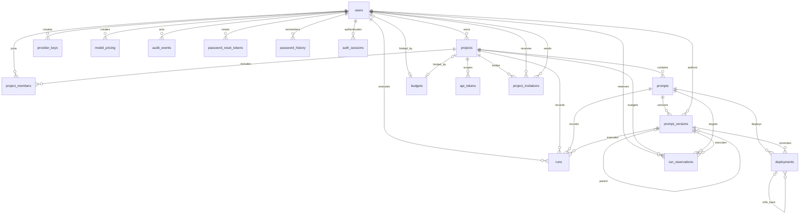

# PromptVault v1 entity relationships

## Entity summary

| Entity | Identity and ownership | Important invariants |
|---|---|---|
| `users` | UUID; normalized `citext` email | Case-insensitive unique email; `user`/`admin`; last active admin protected |
| `projects` | Owned by one user | Globally unique stable key; owner membership inserted automatically |
| `project_invitations` | UUID; references project, recipient and inviter | Single-use hashed token; pending invitations grant no access |
| `project_members` | Project/user composite key | No duplicate membership; owner membership cannot be deleted |
| `prompts` | Belongs to one project | Key unique within project |
| `prompt_versions` | Belongs to one prompt and author | Immutable; unique per-prompt version; parent must belong to same prompt |
| `runs` | User/project/prompt/version ledger row | Append-only; monthly range partition; exact decimal cost |
| `model_pricing` | Provider/model effective window | Nonnegative prices; no overlapping effective windows |
| `budgets` | Exactly one user or project target | One row per target; nonnegative monthly limit |
| `deployments` | Prompt/version/environment event | Version belongs to prompt; one active event per prompt/environment |
| `api_tokens` | Scoped to one project | Only prefix and SHA-256 hash persist; revocation metadata retained |
| `provider_keys` | Created by an administrator | Encrypted value only; active aliases unique per provider |
| `audit_events` | Optional actor plus resource snapshot | Append-only; sensitive fields removed by trigger |
| `password_reset_tokens` | Hashed one-time token for one user | Expiring, single-use; plaintext never stored |
| `password_history` | UUID identity; unique user/hash history | Trigger-maintained Argon2id history; reuse checks |
| `auth_sessions` | JWT `jti` for one user | Expiry and explicit revocation metadata |
| `run_reservations` | User-scoped idempotency key | Pre-call budget reservation; terminal/uncertain reconciliation |
| `schema_migrations` | Numeric migration version | Immutable filename/name/checksum tracking |

## Relational schema mapping

Primary keys are underlined conceptually below; arrows name foreign-key targets. The complete column types/defaults are executable in `db/migrations`, while this mapping establishes that every physical table derives from the ER model.

| Relation | Primary key | Foreign keys / alternate keys |
|---|---|---|
| `users` | `id` | `email` unique (case-insensitive) |
| `projects` | `id` | `owner_id → users`; `key` unique |
| `project_invitations` | `id` | project/recipient/inviter → corresponding entities; `token_hash` unique; partial unique pending project/recipient |
| `project_members` | `(project_id, user_id)` | both columns and `added_by → users` |
| `prompts` | `id` | `project_id → projects`; `(project_id,key)` unique |
| `prompt_versions` | `id` | `prompt_id → prompts`, `parent_version_id → prompt_versions`, `created_by → users`; `(prompt_id,version_number)` unique |
| `model_pricing` | `id` | `created_by → users`; non-overlapping `(provider,model,effective window)` |
| `budgets` | `id` | exactly one of `user_id → users` or `project_id → projects`; partial unique target |
| `provider_keys` | `id` | `created_by → users`; active `(provider,alias)` unique |
| `api_tokens` | `id` | `project_id → projects`, creator/revoker → `users`; `token_hash` unique |
| `deployments` | `id` | composite version/prompt reference; requester/reviewer → `users`; rollback → `deployments` |
| `runs` | `(id, created_at)` | user/project/prompt/version references; range-partitioned by `created_at` |
| `audit_events` | `id` | optional `actor_user_id → users` |
| `password_reset_tokens` | `id` | `user_id → users`; `token_hash` unique |
| `password_history` | `id` | `user_id → users`; `(user_id,password_hash)` unique |
| `auth_sessions` | `id` | `user_id → users` |
| `run_reservations` | `id` | user/project/prompt/version and optional composite run reference; `(user_id,idempotency_key)` unique |
| `schema_migrations` | `version` | migration `name` and SHA-256 `checksum` are tracked attributes |

`organization_monthly_metrics` and `user_monthly_metrics` are refreshable materialized views over the partitioned run ledger. `prompt_version_lineage`, `deployment_history`, and `monthly_costs` provide read-oriented projections without duplicating source-of-truth data.

## A4 self-profile update boundary

Migration 023 adds only `update_self_display_name`; there are no new entities,
columns, dependencies or cardinality changes. It links the existing authenticated
`users` row and `auth_sessions` row under locks, updates `users.display_name` only,
and uses the existing redacted audit trigger. Session, role and account-security
attributes remain on their separate reviewed flows.

## Project invitation design (2026-10-13, before migration 024)

A project has many `project_invitations`; each invitation targets one existing
user and records the inviting user. Pending invitations are separate from
`project_members` and confer no access. Owner membership remains automatic.

Relation: `project_invitations(id UUID PK, project_id UUID FK → projects,
user_id UUID FK → users, invited_by UUID FK → users, token_hash TEXT UNIQUE,
created_at TIMESTAMPTZ, expires_at TIMESTAMPTZ, accepted_at TIMESTAMPTZ NULL,
revoked_at TIMESTAMPTZ NULL)`. Project/recipient is unique while neither accepted
nor revoked; expired invitations can be replaced. Only SHA-256 hashes persist.
Acceptance locks the invitation, checks expiry, recipient identity and inviter
permission, then inserts membership and consumes the invitation atomically.
Cancellation and acceptance serialize on the same row. Invitations expire after
seven days; SMTP failure rolls back creation. Existing memberships are preserved.
